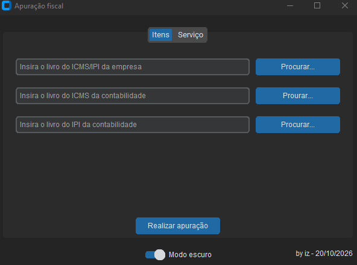
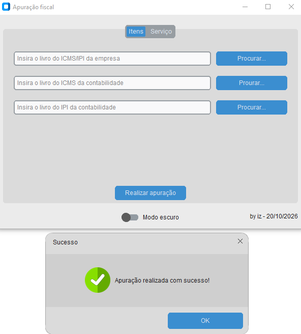
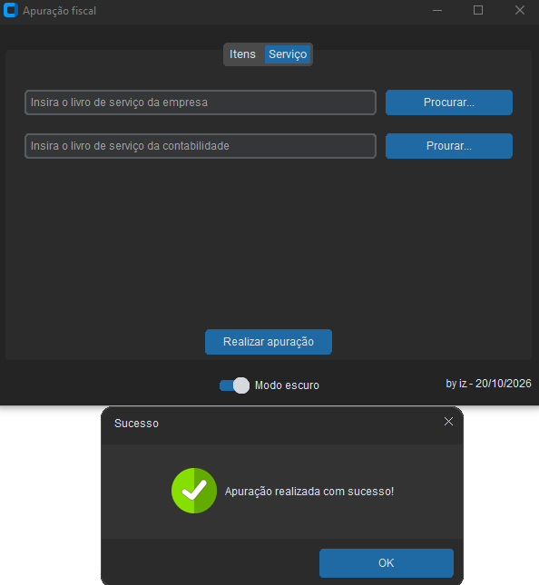
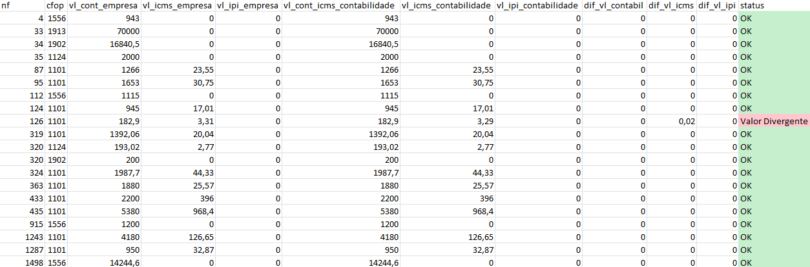

<!-- @format -->

<div style="display: flex; align-itens: center; justify-content: center; flex-direction: column">
    <h1 style="text-align: center; background-color: gray; color: white; border-radius: 5px">Apuração Fiscal</h1>
    <div style="display: flex; align-itens: center; justify-content: center">
    
</div>

### Aplicação desktop desenvolvida em Python para automatizar a conferência das notas fiscais lançadas pela empresa em comparação com os livros e registros disponibilizados pela contabilidade.

## Objetivo

O sistema foi desenvolvido para **agilizar o processo de conferência das notas fiscais (NF-e e NFS-e) lançadas no mês pela empresa e pela contabilidade**.

Antes da aplicação, o fiscal da empresa precisava dedicar praticamente um dia inteiro à conferência dos livros da contabilidade, verificando os lançamentos e identificando possíveis diferenças. Com o sistema, esse trabalho pode ser realizado **com apenas um clique**, após a seleção dos arquivos necessários.

A automatização reduz o trabalho manual e facilita a identificação de notas ausentes ou de valores divergentes entre as bases. O resultado da apuração é exportado para uma planilha Excel, permitindo a análise das informações.

## Funcionalidades

### Apuração de notas fiscais de itens

O módulo de itens compara os dados do livro da empresa com os livros de ICMS e IPI da contabilidade.

Arquivos utilizados na apuração:

1. Livro de entradas/itens da empresa;
2. Livro de ICMS da contabilidade;
3. Livro de IPI da contabilidade.

O processamento utiliza o número da nota fiscal e o CFOP para relacionar os registros. Os valores contábeis, de ICMS e de IPI são comparados entre as bases.

O arquivo Excel gerado contém:

- **Aba `apuracao`:** relação das notas e CFOPs, valores da empresa, valores da contabilidade, diferenças apuradas e status da conferência (`OK` ou `Valor Divergente`);
- **Aba `resumo`:** totais e diferenças de quantidade de notas, valor contábil, ICMS e IPI.

### Apuração de notas fiscais de serviço

O módulo de serviços compara o livro de serviços da empresa com o relatório de notas fiscais de serviço da contabilidade.

Arquivos utilizados na apuração:

1. Livro de serviços da empresa;
2. Relatório de notas fiscais de serviço da contabilidade.

Os registros são relacionados pelo número da nota fiscal e pelo CPF/CNPJ do prestador, com a retirada de caracteres de formatação do documento. Em seguida, os valores dos serviços são comparados.

O arquivo Excel gerado apresenta os dados correspondentes da empresa e da contabilidade, além da diferença entre os valores dos serviços.

## Tecnologias utilizadas

- **Python:** linguagem de programação utilizada no desenvolvimento.
- **CustomTkinter:** construção da interface gráfica desktop.
- **Pandas:** leitura, tratamento, agrupamento e comparação dos dados das planilhas.
- **OpenPyXL:** leitura, escrita e formatação de arquivos Excel.
- **PyInstaller:** geração do executável para Windows.

## Bibliotecas e documentação

As bibliotecas e versões abaixo correspondem à lista de dependências informada para o projeto. Os links direcionam para a documentação oficial ou para a página do projeto/PyPI, conforme disponível.

| Biblioteca                                                                            |      Versão | Documentação / projeto                                                 |
| ------------------------------------------------------------------------------------- | ----------: | ---------------------------------------------------------------------- |
| [altgraph](https://altgraph.readthedocs.io/)                                          |      0.17.5 | [PyPI](https://pypi.org/project/altgraph/)                             |
| [CTkMessagebox](https://github.com/Akascape/CTkMessagebox)                            |         2.7 | [GitHub](https://github.com/Akascape/CTkMessagebox)                    |
| [customtkinter](https://customtkinter.tomschimansky.com/)                             |       6.0.0 | [Documentação](https://customtkinter.tomschimansky.com/documentation/) |
| [darkdetect](https://github.com/albertosottile/darkdetect)                            |       0.8.0 | [GitHub](https://github.com/albertosottile/darkdetect)                 |
| [et_xmlfile](https://pypi.org/project/et-xmlfile/)                                    |       2.0.0 | [PyPI](https://pypi.org/project/et-xmlfile/)                           |
| [numpy](https://numpy.org/)                                                           |       2.5.3 | [Documentação](https://numpy.org/doc/)                                 |
| [openpyxl](https://openpyxl.readthedocs.io/)                                          |       3.1.5 | [Documentação](https://openpyxl.readthedocs.io/en/stable/)             |
| [packaging](https://packaging.pypa.io/)                                               |        26.3 | [Documentação](https://packaging.pypa.io/en/stable/)                   |
| [pandas](https://pandas.pydata.org/)                                                  |       3.0.6 | [Documentação](https://pandas.pydata.org/docs/)                        |
| [pefile](https://github.com/eroc고/pefile)                                            |   2024.8.26 | [PyPI](https://pypi.org/project/pefile/)                               |
| [Pillow](https://python-pillow.org/)                                                  |      12.3.0 | [Documentação](https://pillow.readthedocs.io/en/stable/)               |
| [PyInstaller](https://pyinstaller.org/)                                               |      6.22.3 | [Documentação](https://pyinstaller.org/en/stable/)                     |
| [pyinstaller-hooks-contrib](https://github.com/pyinstaller/pyinstaller-hooks-contrib) |      2026.8 | [GitHub](https://github.com/pyinstaller/pyinstaller-hooks-contrib)     |
| [python-dateutil](https://dateutil.readthedocs.io/)                                   | 2.9.0.post0 | [Documentação](https://dateutil.readthedocs.io/en/stable/)             |
| [pywin32-ctypes](https://github.com/enthought/pywin32-ctypes)                         |       0.2.3 | [GitHub](https://github.com/enthought/pywin32-ctypes)                  |
| [setuptools](https://setuptools.pypa.io/)                                             |      84.0.0 | [Documentação](https://setuptools.pypa.io/en/latest/)                  |
| [six](https://six.readthedocs.io/)                                                    |      1.17.0 | [Documentação](https://six.readthedocs.io/)                            |
| [tzdata](https://pypi.org/project/tzdata/)                                            |      2026.4 | [PyPI](https://pypi.org/project/tzdata/)                               |

> **Observação:** `uuid`, `sys` e `pathlib` também são utilizados no código. Esses módulos fazem parte da biblioteca padrão do Python e não precisam ser instalados separadamente.

## Pré-requisitos

Antes de instalar o sistema, tenha em mãos:

- Windows;
- Python instalado e disponível no terminal;
- Arquivos Excel de origem nos formatos aceitos pelo `pandas` (por exemplo, `.xlsx`);
- Os arquivos do projeto, mantendo a estrutura de pastas e os módulos internos.

A versão do Python deve ser compatível com as versões das dependências utilizadas. Recomenda-se utilizar uma versão de 64 bits.

## Instalação

### 1. Obter o projeto

Clone o repositório:

```bash
git clone https://github.com/IMoisasZ/apuracao_fiscal.git
```

Ou faça o download do projeto pelo GitHub e extraia os arquivos.

### 2. Acessar a pasta do projeto

```bash
cd apuracao_fiscal
```

### 3. Criar um ambiente virtual

```bash
python -m venv venv
```

### 4. Ativar o ambiente virtual

No Prompt de Comando do Windows:

```bash
venv\Scripts\activate
```

No PowerShell:

```powershell
.\venv\Scripts\Activate.ps1
```

### 5. Instalar as dependências

Execute o arquivo `requirements.txt`:

```bash
python -m pip install --upgrade pip
pip install -r requirements.txt
```

### 6. Executar o sistema

Com o ambiente virtual ativado, execute:

```bash
python app.py
```

O arquivo `app.py` inicializa a interface gráfica por meio da classe `LayoutSystem`, definida no módulo `src.views.layout`.

## Gerar o executável (.exe)

O projeto utiliza o **PyInstaller** para empacotar a aplicação Python em um executável para Windows.

Com o ambiente virtual ativado e as dependências instaladas, execute o comando abaixo na pasta raiz do projeto:

```bash
pyinstaller --noconfirm --clean --onefile --windowed --name ConferenciaNF --collect-all customtkinter --collect-all CTkMessagebox --add-data "src;src" app.py
```

### Significado dos parâmetros

| Parâmetro                     | Finalidade                                                                                    |
| ----------------------------- | --------------------------------------------------------------------------------------------- |
| `--noconfirm`                 | Substitui arquivos de uma compilação anterior sem solicitar confirmação.                      |
| `--clean`                     | Limpa arquivos temporários de compilações anteriores.                                         |
| `--onefile`                   | Gera um único executável.                                                                     |
| `--windowed`                  | Executa a aplicação sem abrir a janela do terminal.                                           |
| `--name ConferenciaNF`        | Define o nome do executável.                                                                  |
| `--collect-all customtkinter` | Inclui os recursos e arquivos necessários do CustomTkinter.                                   |
| `--collect-all CTkMessagebox` | Inclui os recursos e arquivos necessários do CTkMessagebox.                                   |
| `--add-data "src;src"`        | Inclui a pasta `src` no pacote. No Windows, utiliza-se `;` para separar a origem e o destino. |

Após a conclusão, o executável deverá estar na pasta:

```text
dist/
└── app.exe
```

### Alternativa: gerar uma pasta com os arquivos do programa

Se preferir distribuir o executável acompanhado dos arquivos necessários, em vez de gerar um único arquivo, remova a opção `--onefile`:

```bash
pyinstaller --noconfirm --clean --windowed --name ConferenciaNF --collect-all customtkinter --collect-all CTkMessagebox --add-data "src;src" app.py
```

Nesse formato, distribua a pasta `dist/ConferenciaNF` completa, e não apenas o arquivo executável.

> **Importante:** os comandos acima são uma configuração inicial de empacotamento baseada nos módulos identificados nos arquivos enviados. Como a implementação de `src.views.layout` e de outros módulos internos não foi incluída entre os arquivos analisados, pode ser necessário acrescentar arquivos de recursos, imports ocultos ou ajustes de caminho conforme a estrutura completa do projeto. Faça um teste do executável em um computador que não tenha o ambiente de desenvolvimento instalado.

## Estrutura do projeto

A partir dos imports identificados nos arquivos analisados, a estrutura esperada inclui os seguintes componentes:

```text
apuracao/
│
├── app.py
|
├── others/
|   |__ apuracao_fiscal_com_tela_2.ipynb
|   |__ apuracao_fiscal_com_tela.ipynb
|   |__ apuracao_fiscal.ipynb
|
├── src/
|   ├── components
|   ├── services
|   |   |__ itens.py
|   |   |__ servico.py
|   |
│   ├── views/
│   │   └── layout.py
│   │
│   └── utils/
│       └── formatacao_planilha.py
│
├── .gitignore.py
├── requirements.txt
└── README.md
```

**PS. A pasta Others, são arquivos para para uma visualização mais facil do codigo feito em jupter notebook.**

A estrutura acima é ilustrativa e deve ser ajustada para refletir a organização completa do repositório.

## Imagens do sistema

### Tela inicial


### Apuração de notas fiscais de itens



### Apuração de notas fiscais de serviço



### Resultado da conferência



## Autor

**Moisés Santos**

- **GitHub:** [IMoisasZ](https://github.com/IMoisasZ)
- **E-mail:** [mopri08@gmail.com](mailto:mopri08@gmail.com)

---

Desenvolvido para tornar a conferência fiscal mais rápida, prática e eficiente.
